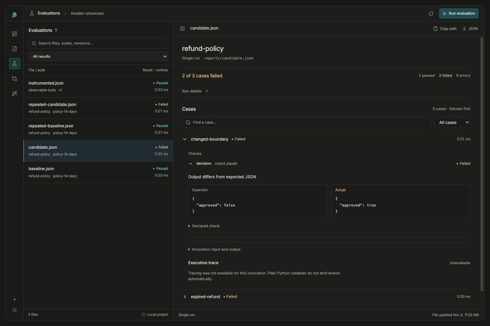

# Thadam (தடம்)

Every agent leaves a trace.

Open-source testing and evaluation for AI agents. Supply test cases and expected
behavior, run your agent locally, inspect failures, and catch regressions before
accepting a change.

**Status:** early development. The Python SDK, CLI, local dashboard, optional
LangGraph tracing, regression/reliability comparisons, baseline review, scenario
suggestions, reviewed regression drafts, recorded-example imports, guided fix
verification, and conversation simulations work from this checkout. [PyPI v0.3.0](https://pypi.org/project/thadam-ai/0.3.0/)
is published; this guide covers newer features on `main`, so use the checkout
below for the dashboard, reliability gates, baseline review, async execution,
scenario suggestions, regression review/import/verification, and conversation
simulations. The distribution name is `thadam-ai`; Python imports and
the CLI use `thadam`.

## Get started

Use Python 3.10 or newer. From a checkout:

```shell
git clone https://github.com/thadam-ai/thadam.git
cd thadam
python -m venv .venv
source .venv/bin/activate
python -m pip install -e '.[dashboard]'

thadam run examples/refund_cases.json \
  --agent examples.refund_agent:run --report artifacts/report.json
```

The controlled example runs five cases without a model API key. To connect your
own agent, expose a `module:callable` and supply your own suite. Async agents are
supported with `--async`; see the guide below for concurrency and lifecycle rules.

## Open the dashboard

```shell
python -m examples.dashboard_demo
thadam dashboard artifacts/dashboard-demo
```

The demo creates a new workspace. The dashboard lets you edit suites, run agents,
inspect evidence, compare results, and review baselines locally. End users need
no Node.js tools or hosted account. See the [dashboard guide](docs/dashboard.md)
for your own project and repeat launches.



Controlled demo data. [Explore the dashboard →](docs/dashboard-tour.md)

## Find what you need

| I want to… | Guide |
| --- | --- |
| Connect an agent, write cases, or use the SDK | [Local runner and assertions](docs/milestones/01-local-runner.md) |
| Suggest cases with ChatGPT or your OpenAI API key | [Reviewable scenario suggestions](docs/milestones/04-scenario-suggestions.md) |
| Simulate conversations and check state | [Conversation and state simulations](docs/milestones/05-simulations.md) |
| Run async agents or overlap cases | [Async execution and concurrency](docs/milestones/03-async-execution.md) |
| Trace a LangGraph agent and check tool calls | [LangGraph integration](docs/milestones/02-langgraph.md) |
| Test tool failures, recovery, and retry bounds | [Controlled tool failures](docs/milestones/05-tool-failures.md) |
| Compare a baseline with a candidate | [Regression comparison](docs/milestones/03-regression-comparison.md) |
| Measure repeated-run reliability | [Reliability gates](docs/milestones/03-reliability.md) |
| Review and approve an intentional baseline change | [Baseline review](docs/milestones/03-baseline-review.md) |
| Create, import, and verify regression cases | [Regression case workflow](docs/milestones/04-regression-cases.md) |
| Browse detailed examples and CLI behavior | [Detailed usage](docs/usage.md) |
| Contribute or understand the project | [Contributing](CONTRIBUTING.md) · [Architecture](docs/architecture.md) · [Roadmap](ROADMAP.md) |

Run `thadam --help` or `thadam <command> --help` for command options.
For release status, see [publishing](docs/publishing.md). Report vulnerabilities
through the [security policy](SECURITY.md).

Thadam (தடம்) means a trace, track, or footprint in Tamil.
Licensed under [Apache 2.0](LICENSE).
