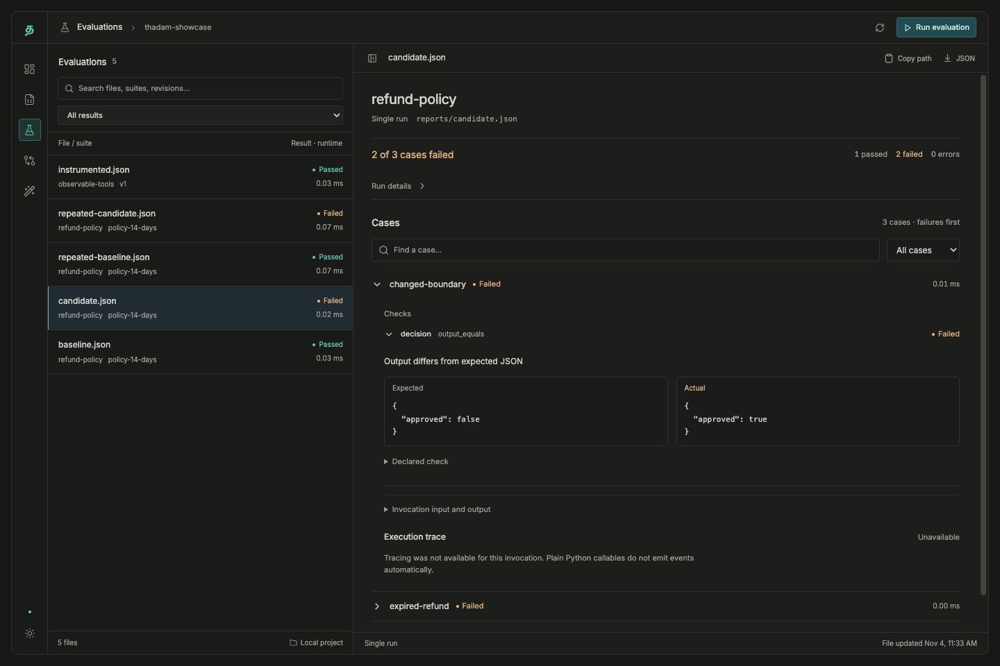
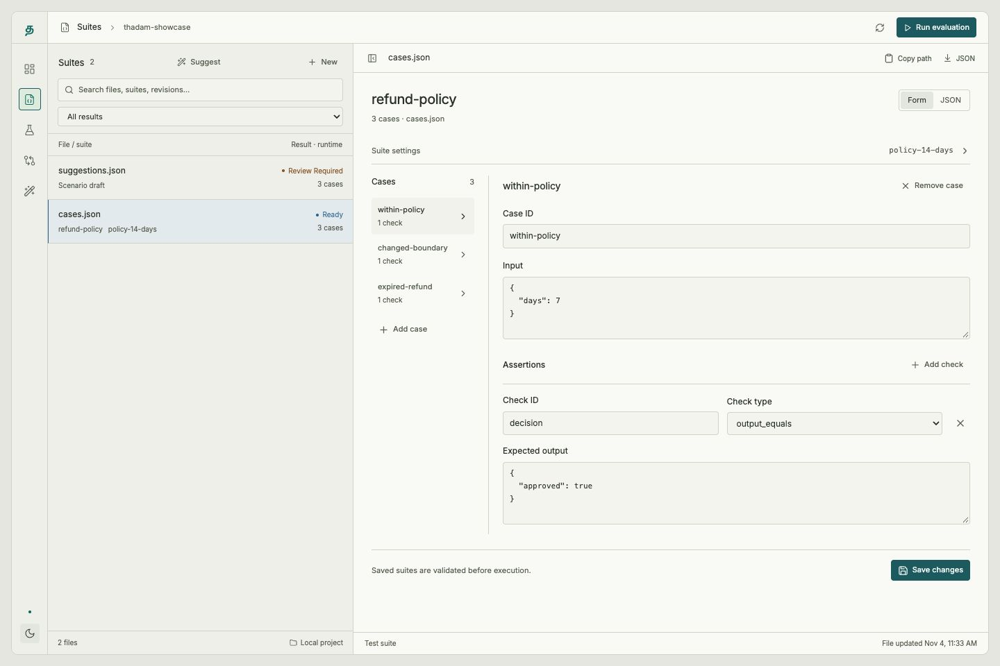
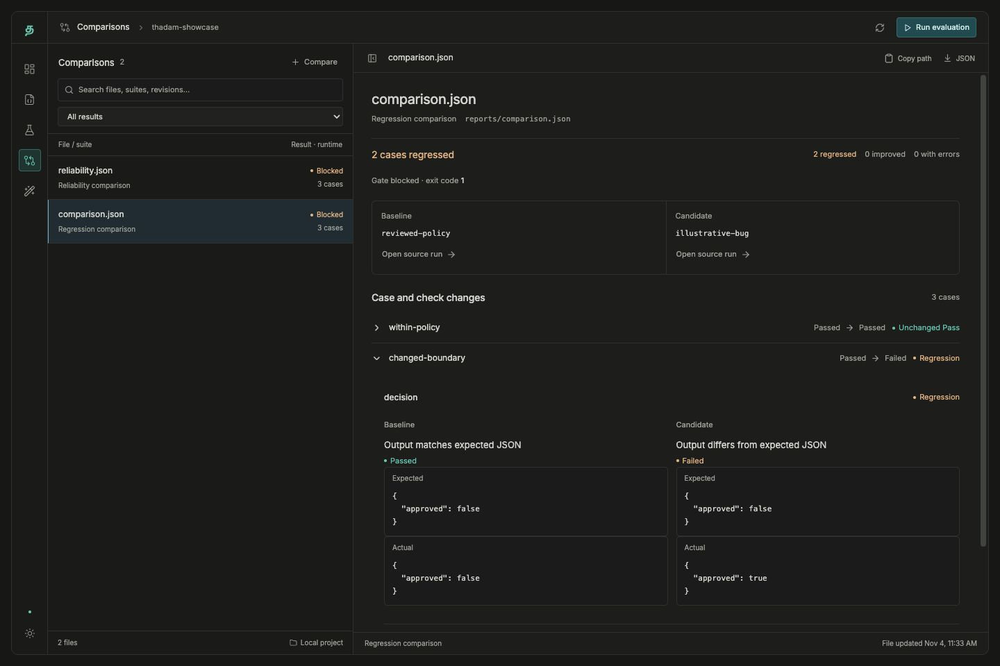
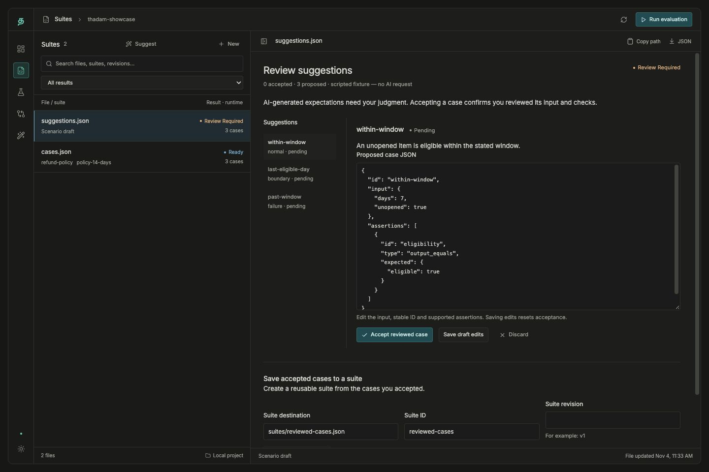

# A tour of the dashboard

Inspect a failure, edit a test, compare a change, and review proposed scenarios in
one local workspace. These are screenshots of the implemented dashboard using
controlled demo fixtures. No live agent, customer data, or model request is shown.

To try it yourself, follow the [dashboard launch guide](dashboard.md#launch-from-vs-code).

## Inspect a failed check

Open a saved evaluation to see unsuccessful cases first. Expand a check to compare
its expected and actual output; invocation data and available traces stay nearby.
This plain Python fixture correctly shows tracing as unavailable.

[Run agents and inspect evidence](dashboard.md#evidence-and-job-lifecycle).

## Edit a reusable suite

Choose a case, edit its input and assertions, then explicitly save the suite.
The light theme uses the same file list, focused editor, and revision guards.

[Suite editing and navigation](dashboard.md#navigation).

## Compare a candidate with a baseline

Review the regression verdict, open changed checks, and inspect both sides of the
saved evidence. This controlled candidate introduces two regressions and blocks
the comparison gate.

[Comparison contracts and CLI usage](milestones/03-regression-comparison.md).

## Review scenario suggestions

Edit each proposed case and explicitly accept or discard it. Accepted cases enter
a runnable suite only after a separate preview and save action. These proposals
come from the scripted generation demo; the screenshot does not show live AI output.

[Connect a provider and review suggestions](milestones/04-scenario-suggestions.md).

Screenshots use two independent controlled examples: the evaluation fixture has a
14-day refund policy; the scenario fixture has a separate 30-day eligibility rule.
Displayed runtimes are demo observations, not performance benchmarks.
See [capture sources and refresh instructions](images/dashboard/README.md).
