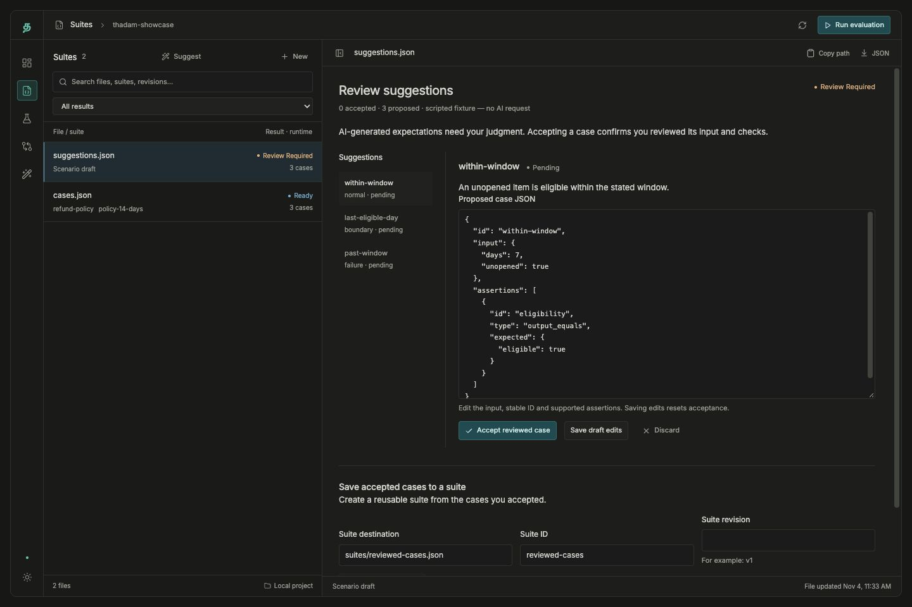

# Reviewable scenario suggestions

Thadam can suggest test cases using either your **ChatGPT subscription** or your
**OpenAI API key**. These are explicit, separate access and billing paths. Thadam
provides no model allowance and never switches providers or billing automatically.
Eligible subscription access depends on OpenAI's account/workspace policy and
available usage. The installed Codex CLI is not required or integrated.

Suggestions are proposals. The supplied behavior contract and a developer's
review establish the expectations; a model cannot establish their correctness.
Generation never executes your tested agent, browses the repository, calls tools,
generates Python verifiers, runs evaluations, or approves baselines.

## Install and connect

From this checkout:

```shell
python -m pip install -e '.[ai,dashboard]'
thadam auth login
thadam auth models --connection chatgpt
```

`auth login` opens the system browser, requests explicit permission to use eligible
ChatGPT plan allowance, and receives the callback on `127.0.0.1`. Use
`--no-browser` to open the printed link yourself on the same machine. Sign-in
expires after five minutes. Signing in without plan permission retains the
identity but blocks subscription generation. Reconnect to authorize it.

For API access, use `thadam auth api-key` to enter a key through a hidden terminal
prompt, or set `OPENAI_API_KEY` in the process environment. Then list models with
`thadam auth models --connection api_key`. Model catalogs are account-specific;
choose a text model that supports Responses and JSON output. Catalog membership
alone does not guarantee support for this workflow. A rejected model produces an
error; Thadam does not silently replace it.

`thadam auth status` displays connection status without credentials.
`thadam auth disconnect --connection chatgpt` removes the saved ChatGPT connection;
use `api_key` to remove a saved API key. Environment keys must be unset separately.
Disconnecting removes local credentials; revoke app permission in ChatGPT settings
when you want to remove the upstream grant too.

Credentials live under `~/.config/thadam/`, shared across local projects and
interfaces. `THADAM_CONFIG_DIR` overrides this for an isolated runtime. They are
never written into draft/report artifacts, project settings, browser storage,
logs, or diagnostics. Unix files use owner-only permissions and the directory
uses `0700`; Windows relies on the user-profile ACL. Access tokens are refreshed
under a cross-process lock, replacing rotating refresh credentials atomically.
One ChatGPT account is active; disconnect before switching accounts or workspaces.
API-key and ChatGPT connections can coexist.

Core imports, case execution, draft review, and suite saving need no AI packages.
Only provider/authentication operations require the optional `ai` extra
(HTTPX and PyJWT with signature verification support).

## Describe the expected behavior

Save a context file:

```json
{
  "description": "A refund eligibility agent",
  "behavior": "Return {eligible:true} for unopened items from day 0 through day 30 inclusive, otherwise {eligible:false}.",
  "examples": [
    {"input": {"days": 7, "unopened": true}, "output": {"eligible": true}}
  ],
  "schemas": {},
  "tool_schemas": [],
  "existing_cases": [],
  "count": 5
}
```

Description and behavior must be non-empty. Provide input/output examples,
schemas, or explicitly selected existing cases. Examples use exactly `input` and
`output`; existing cases use the ordinary suite case shape. Tool schemas are
context only. Count is an integer from 1 to 20, default five. Context is limited to
1 MiB. No project files are discovered or sent implicitly.

```shell
thadam suggest context.json
thadam suggest context.json --connection chatgpt --model YOUR_MODEL \
  --draft drafts/refund.json --send
```

The first command previews the exact normalized context and generation
instructions without a network request. `--send` explicitly authorizes generation.
Use `--connection api_key` for API billing. `--source suites/refunds.json` captures
an existing suite for later appending; it does **not** automatically send its cases.
Copy only the cases you want included into `existing_cases`. Dashboard checkboxes
make that selection explicit.

Provider calls use the public Responses endpoint with `store:false`, streaming,
JSON output, no tools, and no automatic retries. Thadam requires a completed
response, rejects incomplete/refused/malformed responses and late stream errors,
and caps the received stream at 4 MiB before parsing. Individual invalid cases remain draft
proposals with validation issues. A provider may return fewer/different category
counts than requested; the draft retains the requested and actual counts rather
than claiming coverage. Usage is retained only when reported; unavailable is null.

Network operations have a 15-second connect and 45-second read timeout. Streaming
generation also checks a five-minute budget between received chunks. Stopping
a dashboard generation job interrupts its local process; an upstream request may
already have consumed usage. These controls do not introduce agent timeouts or
execution sandbox guarantees.

## Review and save

```shell
thadam review-draft drafts/refund.json --case 1 --decision accepted
thadam review-draft drafts/refund.json --case 2 --decision discarded
thadam review-draft drafts/refund.json --case 3 --decision pending \
  --case-json edited-case.json
thadam save-draft drafts/refund.json --destination suites/refunds.json \
  --suite-id refunds --revision v1
thadam save-draft drafts/refund.json --destination suites/refunds.json \
  --suite-id refunds --revision v1 --write
```

Case numbers start at one. An edited case has exactly `id`, `input`, and
`assertions`. Supported checks are `output_equals`, `output_has_keys`,
`tool_called`, `tool_not_called`, and `tool_arguments_match`, with their existing
contracts. Tool checks require explicit, complete runtime trace evidence.
Unsupported assertions, missing checks, duplicate proposed/existing IDs, or invalid
inputs block acceptance. Missing correctness rules remain incomplete proposals;
the reviewer must supply meaningful expectations. Structural validation does not
prove semantic correctness. There is no bulk "accept everything" action.

Acceptance records a digest of the exact case and an append-only local review
history. Saving edits as pending resets acceptance; subsequent changes require
review again. These records establish local consistency, not reviewer identity or
authenticity. All accepted cases must remain valid when composing the suite.

`save-draft` previews the resulting suite; `--write` is a separate explicit save.
New suites require an ID/revision. Identified source suites retain their ID and
require a different revision. Legacy source suites retain schema 1. Source and
draft fingerprints prevent stale saves. Existing reports, baselines, and unrelated
destinations cannot be replaced. Source suites must still match even when using
Save as; regenerate against the current source after a conflict. Writes are atomic
per file; optimistic guards are not filesystem transactions against unrelated
writers. Draft review and suite writes are separate actions, so a failed suite
save preserves the reviewed draft.

The resulting suite contains ordinary checks and runs without a generation
provider. Run it explicitly with `thadam run`, `repeat`, or the dashboard. Baseline
review and approval remain separate workflows.

## Dashboard



Scripted demo proposals; no live model request is shown.
[See the complete dashboard tour](../dashboard-tour.md).

Open **Suites → Suggest**. Choose your connection, load account models, enter the
behavior contract, optionally select a source suite and individual context cases,
and preview the outgoing context. Acknowledgement enables generation. The
subscription UI names ChatGPT plan use and links to usage settings. API billing is
labeled separately. Usage-limit and permission errors preserve inputs and drafts.

Generation uses the existing one-active-job process controller. Progress indicates
a running request, not invented per-case model progress. Job logs and explicit
Stop remain available. Interrupted or failed jobs never publish completed drafts;
a publication conflict preserves the existing destination and leaves worker
output under the job directory for inspection. A reload retains saved job context
and existing draft artifacts; unsent form edits are not persisted automatically.

Open a saved scenario draft to edit and accept/discard each case. The suite preview
shows the full resulting suite, including original cases. Saving requires a second
acknowledgement and explicit action. Unsaved edit guards cover navigation and case
switches. Both themes and narrow layouts use the existing pane design.

## SDK and custom providers

```python
from thadam import suggest_cases, write_draft, review_candidate, publish_draft
from thadam.providers.openai import OpenAIProvider

provider = OpenAIProvider(connection="chatgpt", model="YOUR_MODEL")
draft = suggest_cases(provider, context)
write_draft(draft, "drafts/new-proposals.json")
# Inspect the proposal, input and expected behavior before accepting:
reviewed = review_candidate(draft, 0, decision="accepted")
publish_draft(reviewed, "suites/new-reviewed.json", suite_id="refunds", revision="v1")
```

`context` is the explicit dictionary above. The core `GenerationProvider` protocol
requires `generate(request) -> GenerationResult`; the result contains candidate
objects, provider/model names and optional response ID/usage. The provider receives
an independent context snapshot. Each candidate has `category` (normal, boundary,
failure), `rationale`, `uncertainty`, and `case`. Implementations must return only
completed proposals or raise an actionable error. No provider is selected at
import time. Callers own custom provider side effects and credentials.

`reviewed_cases(draft, verifiers={case_id: (developer_verifier,)})` assembles SDK
cases using explicitly attached developer verifiers without executing them. This
call is the developer's explicit review action for pending cases completed by
those verifiers. Discarded cases are excluded. SDK callbacks are not serialized
into JSON suites; applications must attach the same verifiers when loading cases
later. Supply explicit verifier revisions for comparable evaluations.

`load_draft`, `write_draft`, `selected_suite` and `publish_draft` expose the same
validation and save rules. Existing writes require the exact file fingerprint;
new destinations default to create-only. For appending, `suggest_cases(...,
source={"path": path, "fingerprint": digest, "data": source_suite})` captures the
source; use an absolute source path in the SDK. The CLI/dashboard capture it for you.

## Draft contract and privacy

A new `kind:"scenario_draft"`, `schema_version:1` artifact stores the generation ID,
creation time, normalized selected context, optional source snapshot/fingerprint,
provider/model metadata, original candidates, editable cases, decisions, exact
review digests and review history. Strict loaders validate it without execution.
All existing suite/run/report/baseline schemas remain unchanged.

Drafts contain the selected context, proposed inputs/expectations and review
history in plaintext. Choose appropriate local paths and review them before
committing or sharing. No credentials or account tokens belong in this context.
Thadam performs no automatic telemetry or context upload; explicit generation sends
the previewed context to OpenAI. This workflow does not read your ChatGPT conversations.

## Controlled demo and verification

```shell
python -m examples.generation_demo --output artifacts/generation-demo
thadam dashboard artifacts/generation-demo
```

The demo uses a scripted provider fixture, labels its origin, and requires no key,
subscription, network, or live agent. It creates a fresh directory and never
accepts or saves runnable tests automatically.

Automated checks cover structural validation, missing correctness, duplicates,
exact review, append-only evidence, stale edits, source revisions, explicit CLI
and API actions, controlled Responses streaming, real signed JWT verification,
PKCE/state/replay, account binding, rotating refresh serialization, interrupted
jobs and publication conflicts. Live authentication/model generation are separate
manual acceptance checks and are not claimed by mocked-provider tests.

OpenAI contracts used: [open-source sign-in](https://developers.openai.com/siwc/token-sharing-open-source/sign-in),
[models and inference](https://developers.openai.com/siwc/token-sharing-open-source/models-and-inference),
[preview limitations](https://developers.openai.com/siwc/token-sharing-open-source/preview-limitations),
[accounts and credentials](https://developers.openai.com/siwc/token-sharing-open-source/profiles-and-sessions),
and [structured output](https://developers.openai.com/api/docs/guides/structured-outputs).
